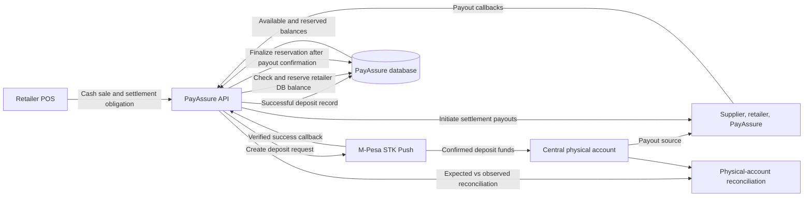
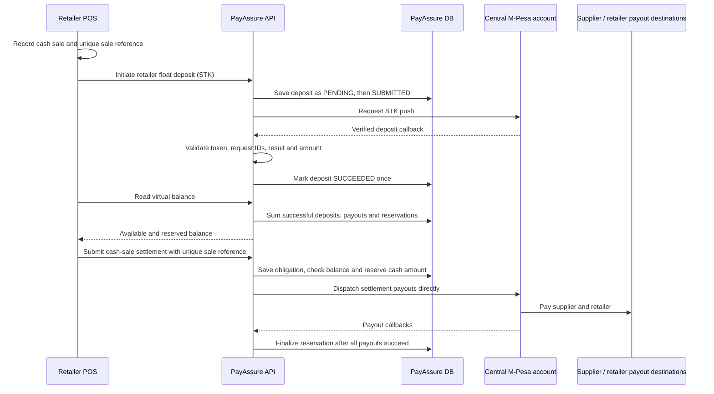

# PayAssure Cash Settlement Flow

This document describes how PayAssure tracks retailer cash-sale obligations against the retailer's database-backed virtual balance. PayAssure uses one centralized physical M-Pesa account; a retailer's balance in PayAssure is a virtual balance, not a separate bank or M-Pesa account.

The virtual balance is derived from successful deposit records and transfer records. A push request is only a request: it does not add funds. Only a successful, validated provider callback marks a deposit as successful and includes it in the balance.

## Architecture



Each retailer has an escrow-float configuration and deposit/transfer records keyed to that retailer's merchant ID. The virtual balance is calculated as:

```text
available = successful deposits - successful payouts - active transfer reservations
```

`dailyFloat` is configuration metadata; it is not the deposited or available balance and cannot be used to manually credit a retailer.

## Cash sale and deposit sequence



The POS records the sale and its unique reference. PayAssure records the settlement obligation when the POS submits it using `merchantTransactionReference`; the cash reservation is linked to that settlement through `settlementId`. A deposit is recorded against the retailer's virtual float only after the STK callback is verified; deposits are not manually assigned a balance. PayAssure checks and reserves the DB-derived available balance, then dispatches supplier and retailer payouts directly from the centralized account. It does not send a retailer-to-platform B2B collection transfer. Keep the sale reference in the POS and settlement metadata so the sale, deposit receipt, and settlement can be reconciled operationally.

The current deposit API is retailer-scoped. The settlement transfer is settlement-scoped. The database does not currently enforce a one-to-one deposit-to-sale relation; a successful deposit contributes to that retailer's balance, which can fund a subsequent cash settlement. Do not treat this as proof that a particular deposit funded a particular sale.

## Retailer escrow API: detailed endpoint contracts

The three retailer endpoints below require `Authorization: Bearer <access-token>`. The authenticated retailer is resolved from the token's user email and active retailer integration. Do not send a `merchantId` in the request to select an account: the server ignores client-selected retailer identity and scopes reads/deposits to the authenticated retailer.

The endpoint paths include the `/escrow` controller prefix.

### 1. Get float configuration and current DB balance

```http
GET /escrow/retailer/float
Authorization: Bearer <access-token>
Accept: application/json
```

No request body or query parameters are required.

Example:

```bash
curl --fail-with-body \
  -H "Authorization: Bearer $ACCESS_TOKEN" \
  -H "Accept: application/json" \
  "$API_BASE_URL/escrow/retailer/float"
```

Success response (`200 OK`):

```json
{
  "merchantId": "pay_retailer_001",
  "currency": "KES",
  "dailyFloat": 10000,
  "depositedBalance": 12500,
  "paidOutBalance": 2000,
  "reservedBalance": 1500,
  "availableBalance": 9000,
  "updatedAt": "2026-11-04T12:19:29.795Z"
}
```

| Response field | Meaning |
| --- | --- |
| `merchantId` | Retailer identified from the authenticated user. |
| `currency` | Currency for the float; currently `KES`. |
| `dailyFloat` | Configured daily-float metadata. This is not a credit or the current balance. |
| `depositedBalance` | Sum of this retailer's `SUCCEEDED` float deposits only. |
| `paidOutBalance` | Sum of this retailer's `SUCCEEDED` escrow transfers. |
| `reservedBalance` | Sum held by active transfers that may still complete. |
| `availableBalance` | `depositedBalance - paidOutBalance - reservedBalance`; this is the amount eligible for a new cash settlement. |
| `updatedAt` | Last update time for the retailer's float configuration; use the balance endpoint's `asOf` for balance-read time. |

This route combines configuration and the retailer's DB-derived balance. It does not call Safaricom and does not return the shared physical-account balance.

Errors:

| HTTP status | Cause |
| --- | --- |
| `401 Unauthorized` | Missing/invalid JWT, or no authenticated user email. |
| `403 Forbidden` | Authenticated user is not associated with an active/live retailer integration. |
| `404 Not Found` | Retailer has no escrow-float configuration. |

### 2. Check the authenticated retailer's virtual balance

```http
POST /escrow/retailer/float/balance
Authorization: Bearer <access-token>
Accept: application/json
```

No request body or query parameters are accepted or required. This POST is retained for existing POS/client compatibility; it performs a database read and **does not** initiate an M-Pesa Account Balance query.

Example:

```bash
curl --fail-with-body \
  -X POST \
  -H "Authorization: Bearer $ACCESS_TOKEN" \
  -H "Accept: application/json" \
  "$API_BASE_URL/escrow/retailer/float/balance"
```

Success response (`201 Created`, NestJS POST default):

```json
{
  "merchantId": "pay_retailer_001",
  "currency": "KES",
  "depositedBalance": 12500,
  "paidOutBalance": 2000,
  "reservedBalance": 1500,
  "availableBalance": 9000,
  "asOf": "2026-11-04T13:23:04.078Z"
}
```

The balance calculation is scoped to the retailer resolved from the token. Pending/submitted deposits are excluded; only successful deposits count. A pending transfer is reserved so the same balance cannot be spent twice. This response is the source to use for cash-payment affordability checks. The settlement initiation flow independently repeats the balance check under its database lock; clients must not rely on a previously read balance as a reservation.

The response fields `depositedBalance`, `paidOutBalance`, `reservedBalance`, and `availableBalance` have the same meanings as in the GET float response above. `asOf` is the timestamp at which this balance response was generated.

Errors:

| HTTP status | Cause |
| --- | --- |
| `401 Unauthorized` | Missing/invalid JWT, or no authenticated user email. |
| `403 Forbidden` | Authenticated user is not associated with an active/live retailer integration. |
| `404 Not Found` | Retailer has no escrow-float configuration. |

`POST /payments/mpesa/escrow-balance` is also retained as a compatibility alias and returns this DB balance for the authenticated retailer. Neither route queries Safaricom. Account Balance callbacks are reserved for legacy/in-flight requests and aggregate physical-account reconciliation; they do not set or overwrite any retailer's virtual balance.

### 3. Initiate a retailer float deposit

```http
POST /escrow/retailer/float/deposits
Authorization: Bearer <access-token>
Content-Type: application/json
Accept: application/json
```

Request body:

| Field | Type | Required | Validation/meaning |
| --- | --- | --- | --- |
| `amount` | integer | Yes | Positive whole KES amount. Example `5000` means KES 5,000. |
| `payerPhoneNumber` | string | Yes | Valid Kenyan number that receives the STK prompt. The API accepts a valid Kenyan phone format and normalizes it to Safaricom format before sending. |

Example:

```bash
curl --fail-with-body \
  -X POST \
  -H "Authorization: Bearer $ACCESS_TOKEN" \
  -H "Content-Type: application/json" \
  -H "Accept: application/json" \
  -d '{
    "amount": 5000,
    "payerPhoneNumber": "0791614036"
  }' \
  "$API_BASE_URL/escrow/retailer/float/deposits"
```

PayBill STK payload mapping:

| Safaricom field | Value |
| --- | --- |
| `BusinessShortCode` | Configured `MPESA_RETAILER_SHORTCODE`. |
| `TransactionType` | `CustomerPayBillOnline`. |
| `Amount` | Requested integer amount. |
| `PartyA` | Normalized payer phone number. |
| `PhoneNumber` | Same normalized payer phone number; this receives the STK prompt. |
| `PartyB` | `MPESA_RETAILER_SHORTCODE` (the PayBill shortcode); no separate `MPESA_RETAILER_PARTY_B` is required. |
| `AccountReference` | Authenticated retailer's registered business name. |
| `TransactionDesc` | Authenticated retailer's registered business name. |
| `CallBackURL` | Server-generated deposit callback URL, including a one-use deposit callback token. |

Example success response (`201 Created`):

```json
{
  "depositId": "clx_float_deposit_001",
  "merchantId": "pay_retailer_001",
  "amount": 5000,
  "payerPhoneNumber": "254791614036",
  "status": "SUBMITTED",
  "merchantRequestId": "ws_CO_001",
  "checkoutRequestId": "ws_CO_002",
  "responseCode": "0",
  "responseDescription": "Success. Request accepted for processing"
}
```

`SUBMITTED` only means Safaricom accepted the STK request for processing. It is not a successful deposit and does not change any balance field. The deposit moves into the virtual balance only after the callback handler verifies the per-deposit token, matching request IDs when present, successful result code, and exact callback amount. The callback updates the deposit once; duplicate callbacks are acknowledged without a second credit.

Errors:

| HTTP status | Cause |
| --- | --- |
| `400 Bad Request` | Missing/invalid body, non-positive or fractional amount, or invalid Kenyan phone number. |
| `401 Unauthorized` | Missing/invalid JWT, or no authenticated user email. |
| `403 Forbidden` | Authenticated user is not an active retailer integration owner. |
| `404 Not Found` | Retailer integration or float configuration was not found. |
| `409 Conflict` | Retailer business name is not configured. |
| `500 Internal Server Error` | Required retailer M-Pesa credentials are missing or Safaricom request failed. |

The deposit is pooled into that retailer's virtual balance; it is not directly tied to one sale. After the deposit callback succeeds, read the balance and then submit the cash-sale settlement using a unique sale/merchant transaction reference.

### Cash-sale settlement

After the deposit callback succeeds, submit the cash sale through the existing settlement initiation API with the cash amount in the `CASH` funding method and a unique sale reference:

```json
{
  "merchantId": "pay_retailer_001",
  "merchantTransactionReference": "POS-BRANCH7-20261104-000184",
  "amount": 5000,
  "currency": "KES",
  "payment": {
    "methods": [
      {
        "type": "CASH",
        "amount": 5000
      }
    ]
  },
  "metadata": {
    "saleReference": "SALE-BRANCH7-000184",
    "branchId": "BRANCH7",
    "invoiceReference": "INV-000184"
  }
}
```

PayAssure verifies the retailer's available DB balance under the retailer-float lock and reserves the cash amount before dispatching settlement payouts from the centralized account. There is no retailer-to-platform B2B transfer. The reservation remains in place until the payout callbacks confirm all expected supplier and retailer payouts. If the available amount is insufficient, initiation fails with the amount available, requested, and shortfall. A later deposit does not automatically resume a failed settlement; the same idempotency reference returns the existing settlement. Confirm the deposit before initiating the settlement, or use the existing operational recovery process for an already-failed attempt.

For mixed `CASH` and `MPESA` funding, the cash balance/reservation applies only to the `CASH` portion. Customer M-Pesa collection remains a separate flow and is not included in this document's cash balance calculation.

Settlement webhooks include `data.cash_funding.amount`, `currency`, and `source` only after a positive cash amount has been reserved from the retailer's virtual balance for payout. This reports the amount drawn; it never includes the remaining/available float balance. It is omitted for M-Pesa-only settlements and while a mixed settlement is still waiting for its customer M-Pesa callback. See [WEBHOOK_INTEGRATION.md](./WEBHOOK_INTEGRATION.md) for the full webhook contract and receiver troubleshooting.

## Balance, reservation, and payout rules

1. **Successful deposits only:** `PENDING` and `SUBMITTED` deposits are excluded. The callback changes the deposit status only after verification.
2. **Available vs reserved:** active transfer states (`BALANCE_PENDING`, `BALANCE_VERIFIED`, `WAITING_FOR_MPESA`, and `TRANSFER_PENDING`) reserve funds and reduce the amount available to another settlement. A timed-out transfer stays reserved until its outcome is known.
3. **Successful payouts:** the cash reservation remains reserved while payouts are pending or failed. Once callbacks confirm all expected supplier and retailer payouts, the linked transfer is marked `SUCCEEDED` and counts as paid out. Failed payouts remain reserved for retry or operational recovery.
4. **No manual credits:** float configuration updates do not alter deposits, payouts, reservations, or available balance. There is no client-supplied balance adjustment.
5. **Cash-only gate:** a successful DB balance check and reservation authorize direct payouts from the centralized account. No retailer-to-platform B2B collection transfer is issued. Supplier and retailer payout callbacks complete the reservation; PayAssure's platform fee follows the existing settlement allocation rules.
6. **Idempotency:** settlement references are unique per retailer; deposit callbacks are idempotent; a settlement has at most one linked escrow transfer.
7. **Reconciliation:** PayAssure computes the expected balance from successful deposits minus successful transfers, requests the configured account-balance check, and records the observed balance and difference from the callback. A mismatch is an investigation condition; the observed provider balance does not silently overwrite retailer virtual balances.

The DB balance endpoint is a PayAssure virtual-balance view, not a real-time statement of the centralized physical account. Use the reconciliation records to compare the aggregate expected balance with the physical account.

## Safaricom configuration

Configure the approved central account, environment, callback base URL, and credentials using deployment secrets/environment variables. The current retailer float deposit and escrow-balance operations read the `MPESA_RETAILER_*` configuration family; they do not automatically use the generic `MPESA_*` values. For PayBill deposits, `MPESA_RETAILER_SHORTCODE` is the business shortcode and `PartyB`, while the payer phone is `PartyA` and `PhoneNumber`. Ensure the retailer escrow configuration is intentionally mapped to the approved centralized account before enabling production deposits. This change does not alter customer M-Pesa collection routes.

Do not put consumer secrets, passkeys, initiator passwords, or other credentials in source code, POS requests, examples, or this document.

## Relevant routes

| Method | Route | Meaning |
| --- | --- | --- |
| `GET` | `/escrow/retailer/float/balance` | PayAssure virtual balance from database records |
| `GET` | `/escrow/retailer/float` | Retailer float configuration and available-balance compatibility view |
| `POST` | `/escrow/retailer/float/deposits` | Request a retailer float deposit; does not itself credit the balance |
| `POST` | `/escrow/retailer/float/transfers` | Initiate standalone retailer escrow transfer |
| `POST` | `/escrow/retailer/float/balance` | Compatibility route returning the same authenticated DB-derived balance |
| `POST` | `/payments/mpesa/escrow-balance` | Compatibility route returning the authenticated DB-derived balance |
